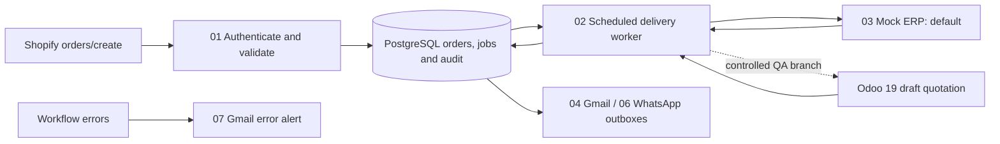

# Order Gateway — n8n + PostgreSQL

Reliable order intake and recoverable ERP delivery for a smaller Shopify integration. The gateway keeps an order and its delivery job together, prevents repeated webhooks from creating repeated jobs, and records what happened when an external system fails.

**Evidence update — 17 October 2026:** the owner confirms activating and testing the WhatsApp failure-notification workflow after Meta template approval. That completed owner-performed test supplements the earlier direct API/outbox evidence. See [notification evidence follow-up](docs/NOTIFICATION-VERIFICATION.md) for provenance and the separate later activation-state observation.

**Status: ready for portfolio demonstration with documented limitations.** Functional and mock reliability QA passed. One genuine Shopify-to-Odoo draft-quotation scenario and its signed replay passed. This is a verified portfolio project, not a production-certified integration.

## Business value

- **Reliable delivery:** accepted orders live in PostgreSQL, independently of a running n8n execution.
- **Duplicate prevention:** separate webhook and business-order identities, durable job uniqueness and stable ERP references.
- **Recoverable failures:** classified failures, scheduled exponential backoff, dead letters and audited operator recovery.
- **Traceability:** persisted receipts, job states and append-only application audit events.
- **Operational visibility:** Gmail alerts and WhatsApp sending have been tested. The custom `order_gateway_failure_alert` template passed Meta API acceptance on 2026-10-13; phone delivery was subsequently confirmed by the user on the same date.

## Architecture

n8n orchestrates; PostgreSQL owns transactional state. The mock ERP is implemented by Module 03 and migration 009, rather than a separate service. The default published worker uses the mock route. The real Odoo JSON-2 branch was verified during controlled QA and restored afterward; its sanitized optional export is included for review, not automatically enabled.

## Demonstrated results

| Capability | Verified evidence |
|---|---|
| Real Shopify intake and Odoo delivery | Shopify **#1018**, source SKU **ABC**, **2 × USD 111**; Odoo **S00048**, draft, product GWDEMO1; subtotal **USD 222**, tax **USD 33.30**, total **USD 255.30**. Executions **1131 / 1132**. |
| Exact signed replay | Execution **1135**, HTTP **200**, duplicate; no additional order, job, receipt or Odoo quotation. |
| Concurrent intake | Eight overlapping signed requests, executions **572–579**; one order/job/mock outcome. |
| Retry and dead-letter recovery | Scheduled workers **684–689**, then recovered delivery **692/693**; backoffs and audit transitions verified. |
| Concurrent workers and crash reconciliation | Overlapping workers **692/694/699**; interrupted worker **713**, recovery **716/717** (see detailed report for chronology and mock reference evidence). |
| Restart persistence | Business-table fingerprints matched; resumed worker **586/587** and replay **590** passed. |
| Notifications | Gmail success **190/191**, failure **197**, error alert **535**; WhatsApp accepted send **252/272**, retry **277**. Previous successful integration evidence is retained. |
| Custom WhatsApp template | **PASS: HTTP 200 — accepted** for `order_gateway_failure_alert` / `en`, approved test recipient, 2026-10-13. Modules 05/06 remained unpublished during that specific direct-API checkpoint; phone delivery is **PASS — user confirmed receipt**. The owner subsequently reports activating and testing the failure-notification workflow after approval. |

The Shopify test had total USD 222 and zero source tax. Odoo applied its existing 15% sales tax. This was an explicitly approved fixture mapping, not proof of general Shopify-to-Odoo tax equivalence.

## Stack and setup

Docker Compose, self-hosted n8n (observed 2.42.6), PostgreSQL 16, SQL/PLpgSQL and n8n JavaScript Code nodes. Optional integrations: Shopify HTTPS webhooks, Odoo 19 JSON-2, Gmail OAuth2 and Meta WhatsApp Cloud API.

1. Copy `.env.example` to private `.env` and replace both placeholders.
2. Start Compose, provision the separate business database and restricted role, then apply migrations 001–013 in order.
3. Import sanitized workflows from `workflows/`, bind your own credentials and publish only the local intake/mock/worker modules initially.
4. Send signed synthetic test orders and verify database outcomes, not just green nodes.

Follow [Setup](docs/SETUP.md) for complete commands and import order. Compose does not automatically initialize the business database or import workflows.

## Repository guide

- [Architecture](docs/ARCHITECTURE.md) and [workflow inventory](docs/WORKFLOW_DESIGN.md)
- [Setup](docs/SETUP.md), [testing](docs/TESTING.md), [operations and recovery](docs/OPERATIONS.md)
- [Data model](docs/DATA_MODEL.md), [design decisions](docs/adr/README.md)
- [Verified testing summary](docs/QA-TEST-REPORT.md) and [release review](docs/RELEASE-REVIEW.md)
- `migrations/`: all 13 actual schema/function scripts
- `workflows/`: Modules 01–07, optional connection diagnostic and Odoo QA export
- `test-order.json`, `concurrent-test.sql`: existing synthetic fixtures

## Boundaries and limitations

Only `orders/create` is supported. There is no new paid-only filter: the live order was paid as a test fixture. General customer/product synchronization, arbitrary SKU mapping, tax reconciliation, refunds, approvals, shipments, stock adjustments and accounting are outside scope. Odoo testing did not confirm quotations or create invoices/pickings.

Leases protect local state; they do not establish exactly-once external effects. The mock has a unique reference constraint; Odoo lookup-before-create is not an atomic uniqueness guarantee. Broader real Odoo concurrency, unknown-outcome faults and backup/restore remain unverified. Custom WhatsApp template API acceptance and user-confirmed phone delivery passed. That specific direct API test did not exercise the scheduled Module 06 outbox path or change its queue, code or configuration. Separately, the owner confirms a later post-approval workflow activation and test; see the notification follow-up. Notification permanent-error classification remains a documented risk.

The Compose n8n image is pinned to 2.42.6, the version used in QA. Clean-volume bootstrap (Compose, database provisioning, migrations 001-013) was verified on 2026-10-13: 8 tables, n8n health 200. Importing the sanitized workflows into a fresh n8n instance was not re-run. Keep credentials, raw customer payloads, logs and volume contents private.

Full internal QA history and unsanitized preparation snapshots are preserved privately and excluded from public release files. The public testing summary reports final verified outcomes and current limitations.

## License

This project is licensed under the [MIT License](LICENSE).
