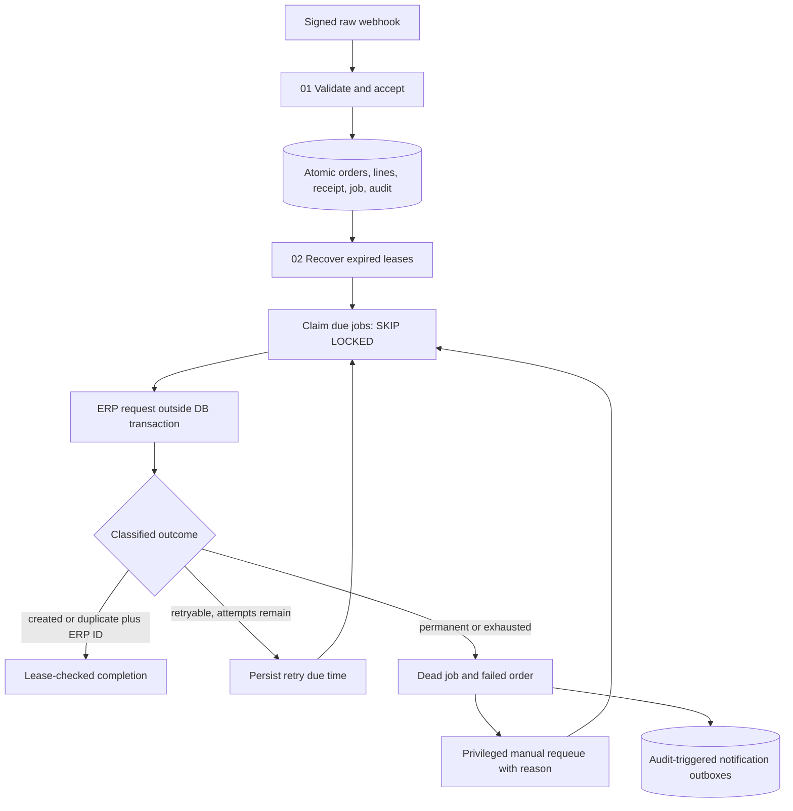

# Architecture

Source of truth: `compose.yml`, migrations 001–013, sanitized workflow exports and [verified testing summary](QA-TEST-REPORT.md). The default implementation delivers to the local mock ERP. Odoo is a separately reviewed QA branch.

## Responsibilities and connections

| Module | Responsibility | Connection |
|---|---|---|
| 01 Shopify intake | Raw-byte HMAC, field checks, atomic acceptance/rejection, HTTP response | PostgreSQL functions; error handler 07 must be rebound after import |
| 02 Delivery worker | Minute schedule, stale recovery, claim up to five jobs, load/map, HTTP call, classify, complete/fail | Mock endpoint 03 by default; error handler 07 |
| 03 Mock ERP | Validate request and persist/reference-deduplicate mock orders | Migration 009; error handler 07 |
| 04 Failure notifications | Recover/claim Gmail outbox, send, complete or fail lease | Gmail OAuth2; durable SQL outbox |
| 05 WhatsApp API test | Manual provider connectivity/template test | Meta API; no durable outbox |
| 06 WhatsApp failure notifications | Recover/claim WhatsApp outbox and send configured custom template | Meta API; inactive in verified baseline |
| 07 Workflow error alert | n8n Error Trigger to Gmail | Selected by 01–03 in workflow settings; independent of delivery outboxes |

## Persistent state

`accept_shopify_order` holds an order-level advisory transaction lock and writes all five intake record types atomically. Unique constraints cover store/order, store/webhook, order/job and order/line identities. Invalid inserts roll back the complete acceptance. Original source SKU, customer object and raw order remain in PostgreSQL; do not publish raw records containing customer information.

An identical webhook ID/hash returns duplicate without a second receipt/audit. A new webhook ID with identical order JSON creates a duplicate receipt/audit, not a new job. Changed `orders/create` data is a conflict; it does not update the order. Authentication happens in n8n, not inside the SQL intake function. Rejection and acceptance use different advisory lock keys; mixed-path concurrency remains a risk.

## Delivery and recovery

`claim_delivery_jobs(5)` uses `FOR UPDATE SKIP LOCKED`, increments attempts and issues a UUID lease. Completion and failure serialize on the job row and reject stale tokens. HTTP work occurs outside the claim transaction. The minute schedule means a 2-second retry deadline is an earliest eligible time, not a guarantee of retry exactly two seconds later.

`fail_delivery_job` schedules deterministic exponential delays 2/4/8/16 seconds before the default fifth-attempt exhaustion; formula caps at 60 seconds for larger budgets. There is no jitter. `recover_stale_delivery_jobs(120,100)` clears expired ownership and requeues or dead-letters according to the attempt budget. An old worker cannot finalize the reclaimed job.

The classifier requires a 2xx response, `created`/`duplicate`, and a nonempty string ERP ID. `invalid`/`conflict` and HTTP 400/409/422 are permanent; other unsuccessful/malformed/transport outcomes are retryable. Authentication errors are not separately permanent in the default classifier. HTTP error output continues to classification. Unexpected execution failure is handled by stale recovery and Module 07.

`requeue_dead_delivery_job(job_uuid, reason)` resets a dead job to queued/attempts zero and audits the previous state. It is deliberately not granted to `gateway_app`; recovery is an operator action. See [Operations](OPERATIONS.md).

## ERP paths

The mock is Module 03 at `/webhook/mock-erp-orders`, backed by `mock_erp_orders` and `accept_mock_erp_order`. Its unique reference prevents concurrent duplicate mock creation. Identical payloads return the same mock ID; changed data conflicts. Payload MD5 is used for mock bookkeeping, not authentication. Business-field validation is in the workflow; the SQL mock function is not a full ERP validator.

The optional Odoo QA export preserves mock routing for nonmatching records. The approved fixture keeps source `ABC` and maps only in the QA branch to product 42 (`GWDEMO1`), partner 15, company 1, tax 1. It uses incoming quantity/price, JSON-2 reference lookup, fixture checks, create only if absent, then order/line readback before local completion. It creates draft quotations only, with mail-suppression context. The fixture IDs/domain/host/database require review in another installation. Do not run both worker variants together.

The controlled real integration verified S00048 from real Shopify #1018 plus exact webhook replay. Mock crash recovery separately demonstrated reference deduplication after external creation. Odoo concurrent-create/lost-response faults were not tested; reference lookup alone does not guarantee external uniqueness. No general customer matching or product/tax adapter is claimed.

## Notifications and security

Audit triggers enqueue terminal/stale dead-event alerts, with unique audit-event IDs per outbox. Notification claim/complete/fail functions have their own leases and durable attempts. Module 04 sends Gmail; Module 06 is custom-template configured but inactive. WhatsApp `sent` means provider acceptance, not a delivery receipt. The custom `order_gateway_failure_alert` / `en` request passed direct API acceptance on 2026-10-13 (HTTP 200 — accepted, approved test number ending2077). Modules 05/06 remained unpublished and the queue/code/configuration were unchanged; this did not exercise the scheduled outbox path. Phone delivery is **PASS — user confirmed receipt** on 2026-10-13. Module 06 supplies retryable=true on failure; permanent Meta errors remain unverified. Module 07 is a direct execution error alert, not a durable SQL outbox.

`gateway_app` receives SELECT on the five core business tables and permitted security-definer function EXECUTE from the supplied migrations. Outbox processing uses controlled functions; additional table grants in an existing installation should be reviewed separately. It has no direct business-write grant in these scripts. Security-definer functions fix their search path and revoke PUBLIC execution. Audit UPDATE/DELETE is blocked by a trigger, which cannot make owner/superuser access tamperproof. Compose binds n8n to loopback, stores both databases and n8n encryption state in persistent volumes, and allows built-in `crypto` for raw HMAC work. Secrets belong in local `.env` or encrypted n8n credentials, never exports.

Module 04 parameter compatibility is verified against the installed PostgreSQL node2.7: its query-parameter conversion accepts the retained leading-equals prefix. This is node-specific behavior, not a general expression-format recommendation. No correction to the running workflow was required.
