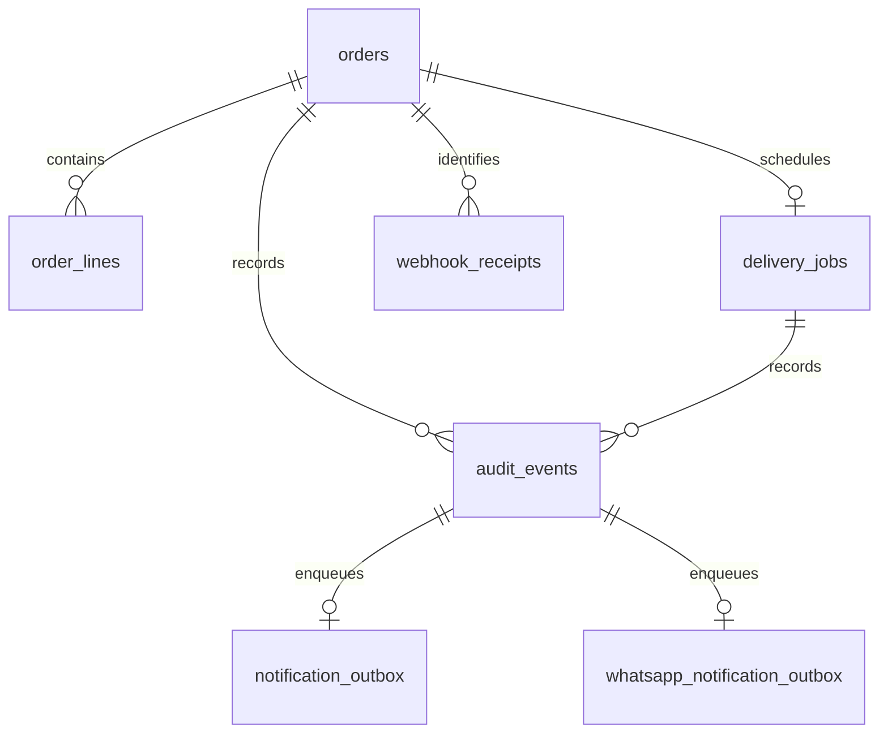

# Data model

Actual DDL is in migrations001–013. n8n uses its own `n8n` database; business state is in separate `order_gateway` on the same PostgreSQL service.

| Table | Identity and purpose |
|---|---|
| orders | UUID; unique store/order and external_reference; source total/customer/raw JSON, accepted/delivered/failed, confirmed ERP ID |
| order_lines | bigint; unique order/source-line; original SKU, positive integer quantity, nonnegative NUMERIC(18,2) unit price |
| webhook_receipts | UUID; unique store/webhook; hash, receipt status, optional order FK, processing/error fields |
| delivery_jobs | UUID; unique order FK; queued/processing/retry/succeeded/dead, attempts/max5, due time, lease, error/completion fields |
| audit_events | bigint; event/details JSON and optional order/job/receipt FKs; mutation-prevention trigger |
| mock_erp_orders | UUID; unique external_reference, payload, payload MD5, created_at; no direct relational order FK |
| notification_outbox | UUID; unique audit_event_id, durable status/attempts/due/lease/error data |
| whatsapp_notification_outbox | UUID; corresponding independent WhatsApp outbox |

Migrations 001–003 define atomic intake/rejection. Migrations 004–008 define claim/complete/fail/stale/manual recovery. Migration 009 provides the mock. Migrations 010/012 create audit-driven outboxes; 011/013 provide their delivery functions. Ready-job and stale-lease indexes support worker selection; order/job audit indexes support investigation.

Business writes use security-definer functions with fixed search_path and explicit execution grants. `gateway_app` has SELECT on the five core tables plus permitted function EXECUTE; manual dead-letter recovery is not granted. Audit append-only enforcement applies to application operations, not unrestricted owner/superuser tampering.

Money is two-decimal NUMERIC in canonical lines/orders, while raw JSON retains source values. Intake does not reconcile line sums/tax/discount/shipping against source total. Duplicate exact replay does not append a second receipt/audit. Hashes are not Shopify authentication inside SQL: orchestration verifies raw-byte HMAC first. Distinct `orders/create` payload conflicts do not implement order updates.
