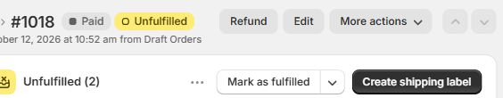

# Verified testing summary

Evidence dates: prior integration QA on 2026-10-12; custom WhatsApp template acceptance on 2026-10-13. Results below describe completed tests, not a production certification. SQL-only checks, actual n8n executions, mock integration and real external integration remain distinct. Full internal execution history is preserved privately and excluded from the public repository.

## Owner follow-up — 17 October 2026

The owner confirms that, after Meta approved the custom WhatsApp template, the failure-notification workflow was activated and tested successfully. This is recorded as owner-performed test and receipt evidence, separately from the 13 October direct API test and earlier outbox executions. A later inactive snapshot is a runtime observation, not evidence that the historical activation/test did not happen. See [notification verification follow-up](NOTIFICATION-VERIFICATION.md). No messages or workflows were triggered by this documentation update.

## Final verified outcomes

| Capability | Layer and result | Evidence |
|---|---|---|
| Validation and authentication | PASS: isolated validation/HMAC checks; actual signed webhook acceptance and rejection independently verified | Current validation assertions 24/24; real signed intake1131; synthetic intake572–579 |
| Atomic order persistence | PASS: direct SQL invalid-second-line rollback left all five intake tables unchanged | SQL function test; not an n8n end-to-end rollback claim |
| Concurrent webhook idempotency | PASS: eight overlapping signed requests yielded one accepted order/job/receipt and seven duplicate replies | Intake572–579; actual worker581/mock582; one durable ERP outcome |
| Durable delivery and mapping | PASS: actual worker delivered both synthetic lines and confirmed matching local/mock reference, quantity, price and total | Worker 581/mock582, USD 30.00, acceptance/claim/success audit95–97 |
| Transient API failure and scheduled backoff | PASS: two controlled503 responses followed by delivery on attempt3, with persisted2/4-second deadlines respected by minute scheduling | Workers684/685/686; mock687 |
| Retry exhaustion and DLQ | PASS: fifth retryable failure produced dead job/failed order and a terminal audit; earlier delays2/4/8/16 seconds | Workers684/685/686/688/689; audit118 |
| Manual recovery | PASS: privileged SQL recovery reset attempts and audited the reason; subsequent actual worker/mock delivery succeeded once | Recovery audit119; worker692/mock693; success audit140 |
| Concurrent workers and leases | PASS: ten jobs completed once while scheduled worker executions overlapped; one claim/current lease/mock reference per job | Workers692/694/699; job attempts1 |
| Post-create crash reconciliation | PASS in mock environment: after interruption following mock creation, stale recovery reused the same external order on attempt2 | Worker 713/mock714; resumed716/717; audit154–156; mock response duplicate |
| Restart persistence | PASS: eight business-table counts/fingerprints matched across PostgreSQL restart; queued delivery and signed replay resumed | Worker 586/mock587, intake590; graceful restart test, separate from crash scenario |
| Gmail notification branches | PASS: provider acceptance/completion and controlled failure branch exercised | Executions 190/191/197; actual workflow error alert535 |
| WhatsApp sending | PASS for previously tested sending/API acceptance and outbox completion/retry; user confirmed those messages worked | Standalone252; outbox272, failure/retry277; prior successful evidence retained |
| Custom WhatsApp template API acceptance | **PASS: HTTP 200 — accepted** | `order_gateway_failure_alert` / `en`; approved test recipient; 2026-10-13; Meta returned a message ID |
| Custom WhatsApp template phone delivery | **PASS — user confirmed receipt** | On 2026-10-13 the user confirmed receiving this custom-template test message on the approved test recipient; evidence source is the user's handset receipt confirmation |

Controlled503 responses and interruption were intentional fault-injection tests, not unresolved delivery defects. One-off fault harnesses are not included as runnable automation; [Testing](TESTING.md) explains the reproducibility boundary.

## Real Shopify → PostgreSQL → Odoo

| Verification | Final result |
|---|---|
| Genuine Shopify order | **#1018**, SKU **ABC**, quantity **2**, unit price **USD 111.00**; paid/unfulfilled fixture. No paid-only filter was added |
| Authenticated intake | **1131**, successful raw-byte HMAC and atomic persistence |
| Actual Odoo delivery | **1132**, product **42/GWDEMO1**, existing demo partner15, draft quotation **S00048 / ID15** |
| Amounts | Source/local total **USD 222.00**, source tax0; Odoo subtotal **USD 222.00**, existing15% tax **USD 33.30**, total **USD 255.30** |
| Local records | One order, line, job and receipt; order delivered, job succeeded, attempts1, ERP ID15 |
| Audit consistency | Acceptance193 → claim194 → success195, linked to the same order/job/ERP reference |
| Exact signed replay | **1135**, HTTP **200**, duplicate/webhook_replay; no second order, job, line, receipt or Odoo quotation; original three audits retained |
| Draft-only boundary | Odoo quotation remained draft, with zero related picking/invoice links. No confirmation, stock or accounting operation issued |
| Restoration and isolation | Default mock worker restored; temporary QA settings restored; no Gmail/WhatsApp notifications sent during reliability/live-order tests |

The target tax difference was explicitly approved and reflects existing Odoo tax configuration. This does not establish general Shopify tax, discount, shipping or customer synchronization. Product aliasing was restricted to the QA branch; source ABC remains unchanged locally. The default worker continues to use the mock ERP.

## Custom WhatsApp template acceptance — 2026-10-13

Codex sent one clearly labeled synthetic test using the saved Module 06 request-body expression and existing credential. Meta returned HTTP 200, a message ID and `message_status: accepted` for `order_gateway_failure_alert`, language `en`, three body text parameters, to the approved test recipient. Test reference: `WA-TEST-20261013051716`; time: **10:17:16 Asia/Karachi**.

During the specific direct API checkpoint described in this section, Modules **05 and 06 remained unpublished/inactive**. No queue, code or configuration changes were made by this test. It was a direct Meta API request, not a new n8n workflow execution or outbox claim/completion test. Existing WhatsApp outbox completion/retry evidence remains separate and preserved. A successful custom-template send supersedes the previous approval/acceptance-pending statement. Actual phone delivery is **PASS — user confirmed receipt**: on 2026-10-13 the user explicitly confirmed receiving this custom-template test message. This confirmation supersedes the earlier unconfirmed status. No independent Meta delivery-status webhook receipt was captured; the delivery evidence is the user's confirmation of handset receipt.

This documentation update records existing evidence only; no new tests were run.

## Current compatibility verification

Module 04's published Fail Notification parameter retains the `=={{` prefix. In the installed PostgreSQL node2.7, string query parameters are normalized with `replace(/^=+/, '')` and evaluated as expressions. Safe tests of the installed node using its default VM expression engine, real workflow data proxy and a stubbed database callback produced the correct four typed parameters for503/401/400 and retryable=true/false/false. **PASS for parameter conversion; no new Gmail send or SQL call.** The generic-prefix warning was a checker false positive, not an established workflow defect. Historical actual Gmail executions remain separate evidence.

## Limitations and remaining verification

- Clean-volume bootstrap (Compose, provisioning, migrations 001-013): **PASS** on 2026-10-13 (8 tables, n8n health 200). Fresh-instance workflow import and actual backup restore: **NOT TESTED**.
- Broader real Odoo fault/unknown-outcome/concurrent-create scenarios: **NOT TESTED**. Mock reliability outcomes do not establish these external guarantees.
- Custom WhatsApp template API acceptance: **PASS** on 2026-10-13. Actual phone delivery: **PASS — user confirmed receipt** on 2026-10-13. That direct API result does not itself establish a new Module 06 scheduled/outbox regression. The owner subsequently confirms activation and testing after approval; that separate evidence is recorded in the follow-up above.
- Mixed accept/reject concurrency and some intake infrastructure-error edge cases remain unverified. Intake does not reconcile arbitrary line sums, tax, shipping and discounts.
- Module 06 currently retries all failed sends; permanent Meta-error classification remains unverified. Odoo lookup-before-create is not atomic external uniqueness.

Assessment: **ready for portfolio demonstration with documented limitations**. No confirmed blocking defect was established by this reconciliation. See [Release review](RELEASE-REVIEW.md) for repository checks and [Testing](TESTING.md) for procedures.
